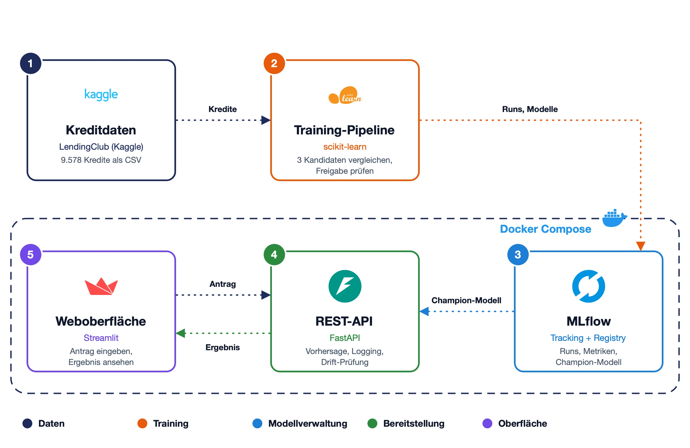
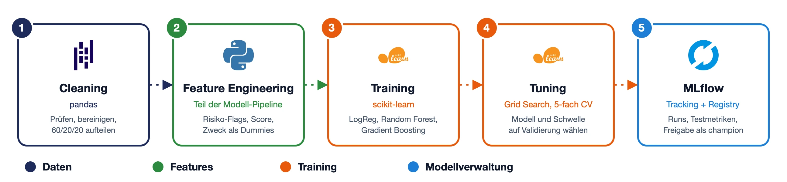

# Kreditausfall-Vorhersage: End-to-End-MLOps-Pipeline

Diese Pipeline schätzt für einen Kreditantrag, wie wahrscheinlich der Kredit ausfällt, und empfiehlt eine Entscheidung. Sie deckt den ganzen Lebenszyklus des Modells ab: Training mit Tracking in MLflow, Freigabe nur von nachweislich besseren Modellen, Bereitstellung über eine REST-API mit Weboberfläche und Überwachung auf Data Drift. Grundlage ist der öffentliche Kaggle-Datensatz [„Loan Data“](https://www.kaggle.com/datasets/itssuru/loan-data) der Kreditplattform LendingClub.


[](https://github.com/ericjoelr/kredit-risiko-mlops-pipeline/actions/workflows/ci.yml)

## Inhaltsverzeichnis

- [Architektur](#architektur)
- [Trainingsprozess](#trainingsprozess)
- [Designentscheidungen](#designentscheidungen)
- [Ergebnisse](#ergebnisse)
- [Voraussetzungen](#voraussetzungen)
- [Setup](#setup)
- [Projektstruktur](#projektstruktur)

## Architektur



1. **Kreditdaten:** Der LendingClub-Datensatz als CSV im Repository.
2. **Training-Pipeline:** Prüft und teilt die Daten, vergleicht drei Modelle mit scikit-learn und gibt das beste nur frei, wenn es besser als das laufende Modell ist.
3. **MLflow:** Speichert jeden Trainingslauf mit Parametern, Kennzahlen und Grafiken und verwaltet die Modellversionen; das freigegebene Modell trägt den Alias `champion`.
4. **REST-API:** Lädt beim Start das freigegebene Modell, beantwortet Anfragen, protokolliert sie und prüft sie auf Data Drift.
5. **Weboberfläche:** Formular für einen Kreditantrag; zeigt die Empfehlung mit Ausfallwahrscheinlichkeit und Kennzahlen des aktiven Modells, alles über die API.

MLflow, API und Weboberfläche laufen per Docker Compose in Containern; das Training startet lokal und schreibt in den MLflow-Container.

## Trainingsprozess



1. **Cleaning:** Prüft Schema und Wertebereiche, behebt kleine Erfassungsfehler und teilt die Daten stratifiziert in Training, Validierung und Test (60/20/20).
2. **Feature Engineering:** Ergänzt Risiko-Flags aus der Datenanalyse, einen Risiko-Score und den Kreditzweck als Dummy-Variablen.
3. **Training:** Trainiert drei Kandidaten: logistische Regression, Random Forest und Gradient Boosting.
4. **Tuning:** Sucht je Kandidat die besten Hyperparameter per Grid Search mit 5-facher Kreuzvalidierung, wählt das beste Modell auf den Validierungsdaten und legt dort die Entscheidungsschwelle fest.
5. **MLflow:** Speichert jeden Kandidaten als eigenen Lauf, bewertet das beste Modell auf den Testdaten, registriert es und gibt es frei, wenn es den Champion nicht verschlechtert.

## Designentscheidungen

- **Feature-Engineering im Modell:** Die abgeleiteten Merkmale entstehen im ersten Schritt der scikit-learn-Pipeline. Training und API rechnen dadurch garantiert gleich, und die API nimmt Rohdaten entgegen.
- **Getrennte Daten für Auswahl und Bewertung:** Modellwahl und Entscheidungsschwelle werden auf einem Validierungsanteil bestimmt; die Testdaten dienen nur der abschließenden Bewertung. So bleiben die berichteten Kennzahlen unverfälscht.
- **Freigabe nach Champion/Challenger:** Ein neues Modell muss eine Mindest-AUC erreichen und auf denselben Testdaten mindestens so gut sein wie das aktive. Erst dann bekommt es in der MLflow-Registry den Alias `champion`, den die API lädt.
- **Drift als Alarm, nicht als Retraining-Auslöser:** Ob ein Kredit ausfällt, zeigt sich erst Monate später. Ohne diese Labels würde ein automatisches Retraining nichts Neues lernen, deshalb meldet die Drift-Prüfung nur, dass jemand hinsehen sollte.

## Ergebnisse

Drei Modelle wurden mit kleiner Hyperparameter-Suche verglichen; ausgewählt wurde nach ROC-AUC auf den Validierungsdaten.

| Modell | ROC-AUC (Validierung) |
|---|---|
| Logistische Regression | **0,667** |
| Gradient Boosting | 0,665 |
| Random Forest | 0,659 |

Die einfachste Variante gewinnt knapp und ist zugleich am leichtesten zu erklären. Auf den Testdaten erreicht sie:

| ROC-AUC | Precision | Recall | F1 |
|---|---|---|---|
| 0,680 | 0,263 | 0,463 | 0,335 |

Das Modell erkennt knapp die Hälfte der späteren Ausfälle; von den abgelehnten Anträgen wäre etwa jeder vierte tatsächlich ausgefallen. Die Merkmale des Datensatzes trennen gute und schlechte Kredite nur begrenzt, und die aus der Datenanalyse abgeleiteten Risikomerkmale verbessern die AUC nicht messbar. Sie bleiben im Modell, weil sie die Vorhersagen nachvollziehbarer machen.

## Voraussetzungen

- [uv](https://docs.astral.sh/uv/) (installiert Python 3.13 selbst)
- [Docker](https://docs.docker.com/get-docker/) mit Docker Compose
- `make`

## Setup

1. Repository klonen und Abhängigkeiten installieren; das Training läuft lokal.
   ```bash
   git clone https://github.com/ericjoelr/kredit-risiko-mlops-pipeline.git
   cd kredit-risiko-mlops-pipeline
   uv sync
   ```
2. MLflow starten. Beim ersten Mal wird das Image gebaut, das dauert einige Minuten.
   ```bash
   docker compose up -d mlflow
   ```
3. Modell trainieren. Das erste Training wird automatisch als `champion` freigegeben.
   ```bash
   make train
   ```
4. API und Weboberfläche starten.
   ```bash
   docker compose up -d
   ```
5. Öffnen: Weboberfläche http://localhost:8501, API-Dokumentation http://localhost:8000/docs, MLflow http://localhost:5050. Die API lässt sich auch direkt aufrufen:
   ```bash
   curl -X POST http://localhost:8000/predict -H "Content-Type: application/json" -d @data/example_request.json
   ```
6. Alles wieder beenden. Trainingsläufe und Modelle bleiben in `mlruns/` erhalten.
   ```bash
   docker compose down
   ```

Ohne Docker laufen dieselben Schritte mit `make mlflow` (eigenes Terminal), `make train` und `make run`. Tests und Linter: `make test` und `make lint`.

## Projektstruktur

```
.
├── src/
│   ├── config.py                    Pfade, Spalten, Schwellenwerte und MLflow-Einstellungen
│   ├── data/                        Laden, Prüfen, Cleaning und Split der Kreditdaten
│   ├── features/                    Feature Engineering (Risiko-Flags, Score, Dummies)
│   ├── models/
│   │   ├── train.py                 Kandidaten, Modell-Pipeline und Grid Search
│   │   ├── evaluate.py              Metriken, Entscheidungsschwelle und Freigaberegel
│   │   └── predict.py               Lädt das Champion-Modell aus der Registry
│   ├── pipelines/
│   │   ├── training_pipeline.py     Trainingsprozess von den Rohdaten bis zur Freigabe (make train)
│   │   └── inference_pipeline.py    Ein Antrag → Wahrscheinlichkeit, Empfehlung, Log-Eintrag
│   ├── monitoring/drift.py          Drift-Prüfung der protokollierten Anfragen (make monitor)
│   ├── api/                         REST-API mit FastAPI und Pydantic-Schemas
│   └── utils/                       Logging und MLflow-Verbindung
├── frontend/app.py                  Weboberfläche mit Streamlit, spricht nur mit der API
├── notebooks/
│   ├── 01_eda.ipynb                 Datenanalyse, aus der die Risiko-Flags stammen
│   └── 02_model_comparison.ipynb    Vergleich der Trainingsläufe aus MLflow
├── data/
│   ├── raw/loan_data.csv            LendingClub-Datensatz
│   ├── example_request.json         Beispielantrag für die API
│   └── predictions/                 Protokoll der Anfragen (nicht versioniert)
├── tests/                           pytest: Daten, Features, Freigabe, Training, API, Drift
├── docker-compose.yml               MLflow, API und Weboberfläche
├── Dockerfile                       Ein Image für alle drei Dienste
├── Makefile                         install, mlflow, train, run, monitor, test, lint
├── .github/workflows/ci.yml         CI: ruff und pytest bei Push auf main und Pull Requests
└── pyproject.toml                   Abhängigkeiten und Tool-Konfiguration (uv, ruff, pytest)
```
